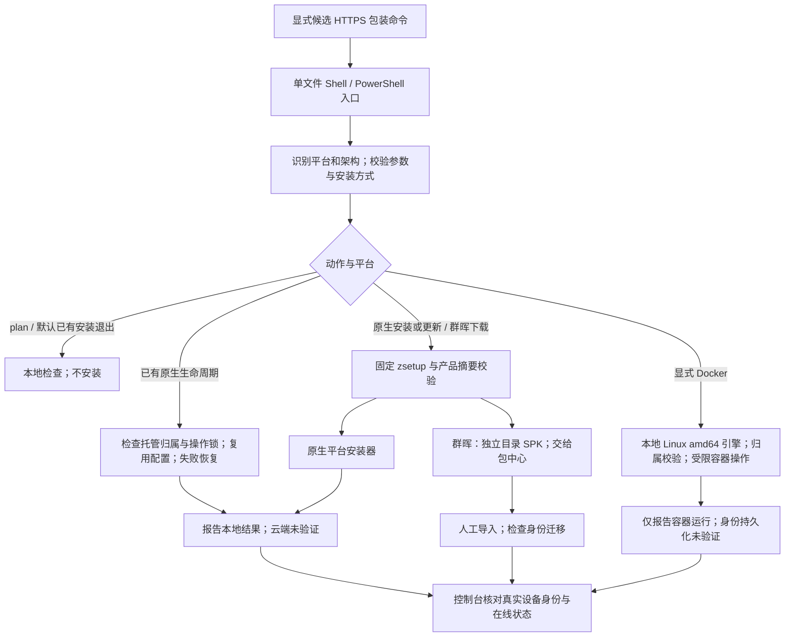
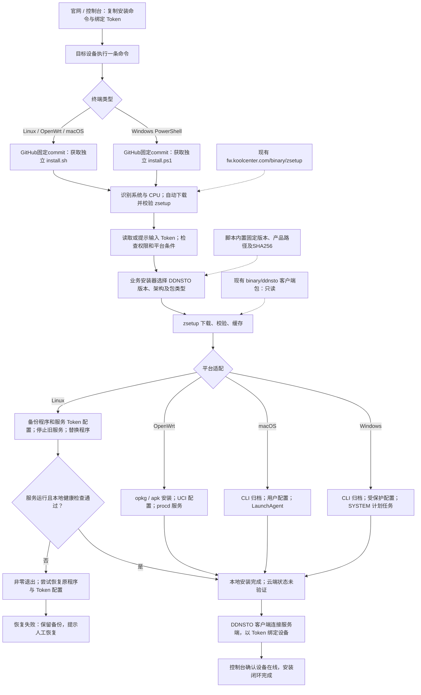

# DDNSTO 一键安装架构与流程

## 0.2.0 候选架构（未发布）

最终用户从明确指定的候选 HTTPS URL 获取独立 `install.sh` 或 `install.ps1`，无需仓库和 zsetup 核心源码。官网默认及旧 0.1.10 测试 URL 不变；只有显式配置候选 URL 的调试环境使用新入口。本地集成证据见 [验证报告](verification-0.2.0.md)，仍未发布或完成原生验收。



| 维护点 | 当前职责与边界 |
|---|---|
| `business.sh`、`main.sh`、`method-selection.sh` | 参数、系统事实、显式方法与动作分发；已识别 NAS 不误入普通 Linux |
| `bootstrap-policy.sh`、共享 `lib/bootstrap.sh` | DDNSTO Linux/OpenWrt 固定 zsetup 0.5.0 与摘要；不跟随 stable、不允许 HTTP 降级；不改变 FastNet |
| `linux-service.sh`、`linux-lifecycle.sh`、`service-management.sh` | 原生服务管理、健康检查和托管生命周期；新增 repair/configure/uninstall 仅可验证归属的 systemd，configure 依赖 jq |
| `openwrt-lifecycle.sh`、`business.sh` | 包管理器/UCI/procd 生命周期；update/保留状态重装临时 UCI 禁用防止包钩子提前启动，再恢复原配置与原 enabled；29 项生命周期、4 项 pinned products 测试通过，后者覆盖 16 组合；包回滚非原子，固件原生待验收 |
| `install-macos.sh`、`install.ps1` | launchd 用户服务 / SYSTEM 任务；macOS 56 项、Windows 7 组模拟测试通过，zsetup 分别固定 0.3.0 / 0.4.0，仍待真机验收 |
| `synology-download.sh` | 仅校验下载 SPK，默认 `$PWD/ddnsto-downloads` 独立子目录；auto/native 可用；download=0、install=20 人工交接，不调用 synopkg |
| `docker-probe.sh`、`docker-lifecycle.sh` | 显式 Linux amd64 候选；写操作 root shell，首次创建及已有管理；update 同 pin no-op、repair 仅 start，身份未验证禁止重建/卸载后重装 |
| `install-rules.json`、`product-pins.sh` | 可审计能力与固定产品来源；不能用规则声明扩大执行器实际能力 |
| `build-entrypoints.py`、`package-entrypoints.py` | 生成自包含入口并打包两个入口/版本副本/摘要/manifest；固定版本目录含 `install-rules.json` 审计元数据，各脚本不依赖该文件独立运行；无需 core，不打包客户端或下载器，不部署 |

原生默认重跑不修改；显式 configure 才更新本地 Token，uninstall 保留配置与身份，后续 install 复用保留状态。该语义不能直接套给 Docker 或群晖。Docker 无 configure，卸载后不得绕过身份保护重新创建；群晖只提供经校验的下载和人工导入提醒。

Linux OpenRC 仅保留 install/update/status；legacy marker 无法认证 shell 服务脚本，其他写动作 fail closed。OpenWrt update 与保留状态重装通过临时提交 UCI `enabled=0` 防止包钩子提前启动，包操作后恢复原配置字节和原 enabled 状态；钩子仍可调用 start，保护依据为已核查包的禁用配置语义。这不是原子包回滚，固件原生行为仍需验收，见 [OpenWrt 集成证据](openwrt-lifecycle-integration.md)。此前全量套件已报告通过，冻结版及真实下载夹具最终结果由主 agent 补填。

本地健康、任务运行、容器运行、云端在线是不同观察。Linux 安装健康检查不能替代其他平台的验收；Docker 不以容器运行证明客户端进程健康。Token 不进入公开文档或发布产物。完整用法、发布边界与外部验收见 [0.2.0 候选说明](candidate-0.2.0.md)。

<details>
<summary>0.1.8 历史架构与验证记录（非当前能力声明）</summary>

> 2026-10-21：下文保留 0.1.8 时点架构。当前已确认的通用命令、分设备命令及群晖/Docker 扩展目标见 [统一命令实施契约](universal-install-contract.md)。0.1.11 仅在本地实现 Linux/OpenWrt 目标约束和已知 NAS 防误装；不代表扩展全部完成，也不依赖 zsetup 核心源码。0.1.10 测试域名仍是既有发布，不因本地修改而改变。

更新：2026-10-14，安装入口候选0.1.8。用户只负责执行适合终端的一条命令、按提示输入控制台 Token；无需手动下载 zsetup、克隆仓库或选择架构包。

**下载站只读，入口先从 GitHub 固定 commit 获取。** `/binary/zsetup/` 及已有客户端包直接复用；业务版本、路径和SHA256内置在入口，不补写下载站的任何文件。此前 `web.toany.net` 隔离目录不是当前架构依赖。命令见[GitHub测试指南](github-testing.md)。

## 整体流程



图中官网/控制台是产品交互目标，不表示本轮已上线新的页面组件。OpenWrt/macOS/Windows 分支已有脚本实现，但本轮增强的“进程归属＋HTTP 健康确认”只落实在 Linux；不能把流程图当作所有分支已经完成原生验收。

## 谁负责什么

| 部分 | 职责 | 不负责 |
|---|---|---|
| 官网 / 控制台 | 提供适合终端的命令、Token 复制及设备在线确认 | 不让用户手动选择或下载 zsetup |
| `zsetup-scripts/ddnsto` | 参数、Token 交互、平台适配、安装和恢复 | 不重新实现下载内核，不构建客户端核心 |
| `zsetup` | 获取平台事实，下载源选择、下载、SHA256 校验和下载缓存 | 不理解 DDNSTO 绑定账号或操作业务配置 |
| 既有下载站 | 提供已经发布的 zsetup 与客户端包 | 当前测试不要求新增入口或业务摘要文件 |
| 安装器维护者 / GitHub | 核验产品字节并固定摘要，发布版本化入口 | 不跳过校验，不随远端指针自动更新客户端 |
| `clients/ddns-client` | 实际设备连接、身份与绑定协议、服务运行、本地状态接口 | 不负责官网命令分发 |
| DDNSTO 服务端 / 控制台 | 根据 Token 识别所属用户，维护设备与在线状态 | 不把脚本退出0直接视作设备在线 |

Token 是长期有效的设备绑定凭据，不是一次性下载授权码，也不是客户端安装包版本。当前没有 Token 重置功能，本方案不新增或假设该能力。安装进度、日志与公开发布目录不得包含真实 Token。

## 当前代码落点与分发

```text
scripts/zsetup-scripts/
  ddnsto/business.sh          Linux / OpenWrt 业务流程
  ddnsto/product-pins.sh      已核验固定版本和21个产品摘要，嵌入入口
  ddnsto/linux-service.sh     Linux 前置检查、健康验证及恢复
  ddnsto/install-macos.sh     macOS 维护源码，构建时嵌入统一 Shell
  ddnsto/install.ps1          Windows 独立入口
  lib/bootstrap.sh           Linux / OpenWrt 自动获取 zsetup
  scripts/build-entrypoints.py
    └─ 生成 ddnsto/install.sh（单文件，设备不需要相邻源码）
  scripts/package-entrypoints.py
    └─ 生成入口候选、版本副本与摘要，不包含客户端产品包

GitHub / linkease/zsetup-scripts / <固定commit>/ddnsto/
  install.sh、install.ps1
现有 fw.koolcenter.com/binary/（只读）
  ddnsto/linux-binary/<既有tar>
  ddnsto/openwrt/<固定版本主包>
  ddnsto/openwrt/<根目录LuCI与语言包，按内置摘要校验>
  zsetup/stable
  zsetup/0.4.0/<已发布 Linux/Windows 原生程序及 SHA256SUMS>
  zsetup/0.3.0/<本轮 macOS 仍使用的原生程序及 SHA256SUMS>
```

直接执行 `install.sh` / `install.ps1` 不经过 `zsetup install ddnsto` 索引，因此不要求设备事先准备索引、开发工具或 zsetup 源码。完整索引安装是另一条尚待验收的管理路径。

Linux/OpenWrt 跟随官方 stable，当前已验证0.4.0；Windows固定0.4.0及官方摘要。macOS0.4.0虽有下载文件，但上游发布验收标为未做原生验收的候选，本轮不自动升级它。下载工具版本与 DDNSTO 客户端版本是两回事。

## Linux 0.1.6 成功判定

1. Linux 系统服务安装必须是 root 或可用 sudo，不再以目标目录可写来推断权限足够。
2. 必须具备可用 systemd 或已初始化 OpenRC；没有服务管理环境则在业务下载、替换程序之前退出2。普通无 init 容器不被当作完整 Linux 服务环境。
3. 停止旧服务由服务管理器执行并检查状态，不依赖旧客户端可能错误的退出码。
4. 安装后最多轮询10次。除了服务管理器报告运行，还读取客户端自己的 `.ddnsto_http_addr.json`，核对 `/proc/PID/exe` 对应本次安装路径，再请求实际 loopback 端口的 `/healthz`。不假定固定18333端口，也不只检查是否存在同名进程。单次 HTTP 最多2秒，轮询间隔1秒。
5. 健康接口须返回 `ok`；不要求云端已连接。通过才输出 `local_service=healthy cloud_status=unverified`。不通过返回13，并尝试恢复原程序及原来的服务 Token 配置。
6. 恢复旧服务时不使用新 Token 覆盖旧配置。恢复失败保留私有备份目录，并明确提示人工处理；不宣称所有平台都具备完整回滚。

仅支持 systemd/OpenRC 是本轮明确的服务验收边界。其他 init 系统不能静默当作支持。Linux 当前仍要求重装时提供 Token；无服务配置的历史裸二进制安装，不保证能自动恢复为托管服务。

## 发布与验证边界

- 0.1.8走GitHub测试分支，固定commit链接；无需下载站上传权限。0.1.7上传方案留作历史，当前验证以[GitHub测试指南](github-testing.md)为准。

- 已有测试候选：`https://web.toany.net/ddnsto-install-test/20261014-016/binary/ddnsto/install.sh`，旧 `20261014-015` 保留。**不是正式安装地址，也不是全平台公开发布。**
- 此测试命名空间只补齐 Linux x86_64 下载链路。下载测试站的脚本，不会自动把客户端连接地址切换到测试后端。
- 正式推广仍需全平台 canary；群晖/QNAP/厂商路由器等既有专用安装方式没有因此自动变为统一入口已适配。上游更新同名LuCI文件可能使旧固定入口校验失败，需维护者核验后发布新安装器。
- 系统开机自启、ARM64、OpenWrt/macOS/Windows 真机、真实 Token 绑定与控制台闭环、跨版本更新仍需专项验收。
- 本轮结果见 [服务误报修复与验证](verification-2026-10-14-service-fix.md)；之前真实服务误报证据见 [0.1.5 测试部署](verification-2026-10-14.md)。

</details>
