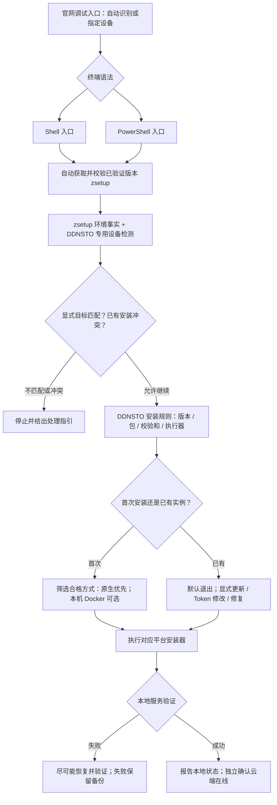

# 通用命令与分设备命令实施契约

日期：2026-10-21。来源：用户确认 grill-me Q1–Q23，最终确认不需要 zsetup 核心源码，只依赖已发布能力。产品权威记录为 ddnsto-meta 中《DDNSTO统一安装与更新产品设计》§2.6；本文件管理工程落点和未交付边界。

## 0.1.16 Windows 本地任务修复

当前本地候选 0.1.16，未提交、推送或发布。新增 PowerShell `-Action repair`，其他平台未接入该动作；默认重跑菜单仍是退出/更新。

- 必须有本安装器托管标记、普通 EXE/配置文件，路径不允许 reparse point；计划任务可以缺失。若同名任务存在，必须只有一个 action 且 EXE、配置参数、工作目录匹配，否则拒绝覆盖。
- 在安装/管理共用 `.install-lock` 下再次校验，导出原任务 XML，再停止、重建启动任务、启动并确认 Running。完全复用已有程序与配置，不下载、升级、修改 Token 或设备身份。
- 失败尝试恢复原任务 XML；原任务原先 Running 时重新启动并检查，否则不主动启动。没有旧任务时，失败恢复尝试移除新任务。恢复失败保留 `.repair-*` 目录，有旧任务时包含 `old-task.xml`；不宣称必然恢复成功。
- 备份清理失败也会尝试释放锁，不提前输出修复成功。成功输出 `operation=repair local_service=running cloud_status=unverified`。服务运行检查不是二进制健康/云端在线验证。
- 保留平台/方法/权限约束，拒绝 Token/TokenFile 与 Plan 组合。不能用于修复 EXE/配置缺失或损坏、云端连接异常、外部安装插件；不提供任意同名任务接管。

测试覆盖缺失任务恢复、配置/身份/程序字节保留、启动失败后的原任务恢复、原任务不存在时清理、参数和锁冲突、任务所有权拒绝、缺失程序、恢复失败保留备份及备份清理失败仍释放锁。Windows 测试使用 PowerShell 隔离任务 API，不代替 Windows 真机验收。统一卸载及保留配置后的重装衔接仍待实现。

## 0.1.15 安装与管理并发保护

当前本地候选为 0.1.15，未提交、推送或发布。本节替代旧版“Linux/OpenWrt 无共享锁”的描述，不代表全部产品目标完成。

- Linux/OpenWrt 的安装、更新、start/stop/restart 共用 `/var/lock/ddnsto-installer.lock`，通过原子 mkdir 获取，权限 0700；不依赖 flock，不按工作目录或版本划分锁。后到操作获取失败返回 16，不进入业务下载或服务变更；缺少 root/sudo 等前置条件返回 2。
- 获取锁后重新验证安装状态/服务文件，避免交互输入期间发生另一轮安装后仍覆盖文件。锁一直覆盖业务事务与失败恢复；安装事务在独立子 shell 中运行，其清理 trap 不覆盖锁持有者的退出清理。原始业务失败码保留，锁释放失败会报告错误。
- 默认无修改重跑、只读 plan/status 不拿写锁；status 不是与更新隔离的一致性快照。zsetup bootstrap、前期探测/用户输入在业务锁之外。macOS/Windows 保留原有平台锁，不改核心源码或共享 FastNet bootstrap。
- 不自动抢占已有锁、不递归删除锁、不通过 PID 存活猜测锁已失效。可捕获的退出路径尝试释放，SIGKILL/掉电可能遗留锁；管理员必须确认所有相关操作已结束再检查/清理空锁目录。人工服务命令、旧脚本、第三方包管理操作不在互斥范围。
- `DDNSTO_LOCK_DIR` 仅为隔离工程夹具提供绝对路径覆盖，不是用户选择多个实例或绕过锁的公开参数。

验证包括真实竞争 shell、已有目录/符号链接锁不被删除、业务错误码保留、信号退出释放，以及安装更新/服务管理接入测试。安装失败恢复用例检查没有泄漏锁；真实发布 zsetup 的 HTTPS 夹具继续覆盖 OpenWrt 各包架构、Linux 安装/缓存/失败及信号清理。不替代真机验收。

下一步仍需统一卸载和修复/改 Token 流程、NAS/Docker 执行器、版本规则及官网调试入口完善。

## 0.1.14 跨平台服务管理增量

当前本地候选 0.1.14，未提交、推送或发布。既有四类入口统一 status/start/stop/restart；新增 Linux systemd/OpenRC、OpenWrt init、Windows 计划任务执行路径，macOS 继续沿用已有实现。

- 管理从本地入口直接分流，不 bootstrap、不下载客户端，不读 Token 文件、不修改配置/身份；参数拒绝凭据和计划预览组合。Shell 还拒绝安装专用 force-version/verify-status。
- stop 禁用自启并停止受监管服务，start 恢复自启，restart 恢复自启后停止/启动；不是 kill 进程。Linux systemd 使用固定服务名 com.linkease.ddnstoshell，OpenRC 操作 default runlevel，OpenWrt 调用已有 init 脚本，Windows 操作 DDNSTO 任务。
- Linux/OpenWrt 验证主程序和配置普通文件、拒绝符号链接；Linux 检查已加载 unit/已注册 OpenRC 服务。Windows 验证托管标记、单一任务 action 的 EXE/配置参数/工作目录一致，写操作复用安装锁且锁失败不清理他人锁。
- 状态为 local_service 与独立的 cloud_status=unverified；运行不代表云端在线或完整健康检查。systemd 查询失败不当作停止，failed/过渡状态独立报告。缺失/不完整安装拒绝操作，不自动安装；Linux/OpenWrt 暂不提供“未安装”成功状态。
- 当前限制：Linux/OpenWrt 尚无安装/管理共享锁，不支持并发；路径与固定服务名检查不等于完成所有第三方包所有权识别。OpenRC 仅操作 default runlevel，自定义 runlevel 未验收。中途失败可能已改变启用/运行状态，不承诺管理动作回滚。OpenWrt init 对状态码的契约仍需目标固件验证。

验证：新增 POSIX 服务管理隔离测试覆盖 systemd/OpenRC/OpenWrt、主入口不 bootstrap、配置保留、失败传播、缺失文件/链接/unit、错误设备和参数；Windows 覆盖启停/状态、配置、参数、安装锁和同名不同路径任务拒绝。其余安装/更新/恢复与打包回归继续执行；不替代 Linux/OpenWrt/macOS/Windows 真机验收。NAS/Docker 执行器、统一卸载、修复/改 Token 菜单及版本规则仍待开发。

## 0.1.13 重跑与显式更新增量

当前本地候选为 0.1.13；旧段落仅为阶段记录。本增量未发布、提交或推送。

- Linux/OpenWrt/macOS/Windows 默认重跑已有完整安装不改变程序和服务。非交互直接输出 operation=none；交互选择退出（默认）或更新。无操作返回 0 不代表更新、在线或健康验收通过。
- Shell `--action update`、PowerShell `-Action update` 才执行更新；拒绝无已有安装的更新，拒绝随更新传 Token/TokenFile。Token 修改是后续显式流程，不能借更新改变绑定。
- Linux 直接入口在下载 zsetup、创建缓存之前做本地重跑保护，因此离线也可以退出；真正更新仍在 zsetup context 后再次匹配平台。Linux 更新复用旧配置启动，不再将新参数写入 Token；保留原有健康检查和失败恢复。
- macOS/Windows 仍要求完整托管标记与文件；Linux/OpenWrt 检测主程序和配置是否同时存在，拒绝不完整和符号链接文件。此检测不等于已经解决所有旧插件、容器重复实例和包所有权识别。
- 默认重跑菜单目前只有退出/更新，尚缺修改 Token 与修复菜单；不把这些列为已交付。OpenWrt 更新仍复用既有包管理逻辑，不能宣称包级原子回滚或完整实机身份保留已经验收。

验证覆盖：9 项新增重跑测试（含 OpenWrt、离线直接入口、伪终端按回车退出/按 1 更新）、30 项 macOS 行为、Linux 配置保留及失败恢复、Windows 默认退出及显式更新恢复。已有 zsetup 0.5.0 隔离直接入口测试改用显式 update 覆盖冷 bootstrap、缓存与失败恢复；没有把默认退出当作安装通过。

### Docker 发布核查与接入前置

2026-10-21 只读查询 [Docker Hub 4.0.5 元数据](https://hub.docker.com/v2/repositories/linkease/ddnsto/tags/4.0.5)：存在 Linux amd64、arm64、arm/v7、arm/v6 镜像，索引 digest 为 `sha256:55d8cdca2dc8ae8190df175d6cd6be45ebbc1c7d1739ac406ec234e363660480`，最后推送为 2026-04-15。本地 Docker 构建版本文件也是 4.0.5，但本地源码存在此日期之后的改动，因此不能由 tag 同名推定源码与镜像一致。

这是发布元数据证据，不是已拉取/运行镜像或核验其文件。下一步须在隔离容器环境核对该不可变镜像的 Token、配置挂载、身份持久化、网络和日志接口，再实现/验收 create/update/recovery；不能直接跟随 latest 或宣称所有 Docker 设备可安装。当前不修改主机 Docker、不推送镜像，也不新增下载站依赖。

## 0.1.12 预览与桌面管理增量

当前本地候选为 0.1.12，未发布；下文 0.1.11 状态是前一增量记录，本节优先。

已实现：

- 所有既有入口提供本地只读预览：Shell `--plan`、PowerShell `-Plan`。不 bootstrap、不要求 Token、不读凭据文件、不创建安装目录、不提权、不调用服务变更；参数错误与目标不匹配明确失败。系统和 CPU 本地初筛的输出明确标记 `facts_source=local-preflight`，实际安装仍使用原有 zsetup 与平台检查，不把预览当完整模拟安装。
- macOS/Windows 补齐显式平台与原生方式约束。Docker 在桌面明确拒绝；Linux/OpenWrt 也未开放 Docker 安装。
- Linux/OpenWrt Docker 只读探测：按 DOCKER_CONTEXT、DOCKER_HOST、当前 context 解析 endpoint；仅接受存在的本地 Unix socket，再以明确 host 查询 info。每条调用限时 5 秒，无 timeout 工具则跳过探测，不修改 context、不启动引擎、不接触远端。Docker Desktop 和非 Linux daemon 单独报告，未校验镜像/架构/网络前始终 `docker_installable=false`。依据：[Docker 官方 context 文档](https://docs.docker.com/engine/manage-resources/contexts/)。本地 Unix socket 不能证明没有人为代理转发，不将此探测作为强安全认证。
- macOS 管理 `--action status|start|stop|restart`：无需下载或 Token，只管理标记完整的既有安装；写操作使用安装锁。stop 执行 disable/bootout 并确认 job 不再加载，start 恢复 enable/bootstrap/kickstart；不删配置和身份。失败非零退出，不宣称已恢复。
- Linux/OpenWrt 的 Token 交互可见，终端状态会恢复；不额外写日志。Windows 仍沿用既有输入行为。

当前版本未完成：统一声明式版本规则、zsetup 固定版本、重跑默认无修改菜单、Linux/OpenWrt/Windows 管理命令、卸载/诊断导出、群晖 SPK 执行器、Docker 安装与方法交互选择、官网对接和真实新平台验收。没有提交、推送或部署。

本轮验证：计划预览 8 项、Docker 探测 8 项、平台约束 12 项、macOS 行为 28 项、POSIX 输入 5 项、Linux 服务 9 项；Windows 使用已有临时工具目录中的 PowerShell 7.4.13 执行 plan/安装恢复/bootstrap 夹具。不是 macOS/Windows 原生验收。打包、生成入口和真实已发布 zsetup 的隔离直接入口测试独立执行，不需要核心源码。

## 目标架构（并非全部已实现）



bootstrap 必须先做最低限度的 OS/CPU 识别才能下载 zsetup；不能要求尚未存在的二进制先执行检测。其后优先消费现有 `context` 字段，补充 NAS 文件标记，不 source 系统配置。不得把系统是 Linux 等同于支持普通 Linux 服务安装。

zsetup 仅承担已验证的查询/下载/摘要能力。DDNSTO 负责业务匹配、方法选择、Token、身份和生命周期。直接入口不依赖 `zsetup install ddnsto`，不修改公共 config、stable 或设备 `/etc/zsetup/config.json`。公共索引没有 DDNSTO 不是直接入口阻塞条件。

## 命令边界

远程稳定命令的具体 URL 在发布时确定，当前不伪造可用命令。官网命令必须保留既有 HTTPS 获取失败检查、脚本类型校验，参数安全传递，不包含 Token。官网正式构建保持旧流程。

0.1.11 **本地 Linux/OpenWrt 候选**可执行：

```sh
sh ddnsto/install.sh --help
# 以下会执行真实安装；只在对应目标设备运行。
sh ddnsto/install.sh --platform linux --method native --token-file /secure/token
sh ddnsto/install.sh --platform openwrt --method native --token-file /secure/token
```

不传平台与方式仍按原有 Linux/OpenWrt 自动选择。`--platform synology|qnap|unraid` 当前用于约束与清晰拒绝，**不表示已能安装这些平台**。`--method docker` 当前返回 2，不能静默原生安装。没有新增 `--plan`、管理子命令或完整无人值守模式，不能将其宣传为可用。macOS/Windows 的显式平台参数留待下一增量；已有桌面调用保持兼容。

最终稳定入口跟随最新已验收安装方案；固定入口保留对应规则。客户端版本与 zsetup 版本分别固定和验证，不盲跟 upstream stable。现有 Linux/OpenWrt bootstrap 的 stable 行为仍需后续改造，FastNet 不应被 DDNSTO 专用 pin 影响。

## 安装规则及包组织

继续维护 `ddnsto/business.sh`、`product-pins.sh`、`linux-service.sh`、`install-macos.sh`、`install.ps1`；`scripts/build-entrypoints.py` 生成自包含 Shell。用户设备不需要相邻源码、Python 或 Git。未来平台执行器作为维护源编入入口或以明确摘要加载，不能无校验执行任意远程脚本。

DDNSTO 声明式规则的目标字段：设备类型、系统版本区间、CPU/ABI、服务管理器、安装方式、客户端与 zsetup 版本、包 URL/大小/摘要（容器使用不可变 digest）、执行器、验收状态及限制。当前产品 pin 只是部分基础；统一规则表、规则编译与完整匹配尚未实现。优先在构建端验证并生成 Shell/PowerShell 可消费内容，不给小型设备增加 JSON 工具依赖。

发布仍使用既有自包含入口打包器，发布稳定别名与不可变版本目录，不重新打包客户端和 zsetup。脚本字节改变必须递增版本；不能覆盖 0.1.10 已发布目录。下载站只读时在既有测试域名/GitHub 托管入口即可，不部署新下载服务器。

## 平台与安装方法约束

- 优先识别专用平台。当前保护范围：Synology `/etc/synoinfo.conf` 或 `/usr/syno`；QNAP `/etc/config/uLinux.conf`；Unraid `/etc/unraid-version`；兼容 context 中相关 os/device 值。标记缺失或其他厂商系统尚未覆盖，不宣称万能 NAS 检测。
- 群晖后续按 DSM 版本与包架构挑选 SPK，复用既有套件配置、升级及启停；`synopkg` 无人值守参数和向导 Token 注入必须实机验证后才开放。
- Docker 后续验证本机 endpoint、引擎可访问、镜像架构、网络能力、权限与持久化路径；只存在 CLI 不算支持。不启动/安装 Docker，不使用远程 context 安装“本机”。
- 不实现原生/容器自动迁移。已有双实例不自动删除；更新保留原方式、Token 与身份。
- 当前实例重跑尚未改造成默认无修改菜单。管理命令和显式修改 Token 需单独实现及验证，不把已有重装流程当作新契约已交付。

## 分阶段验收

| 增量 | 当前状态 | 验证要求 |
|---|---|---|
| Linux/OpenWrt 目标约束、NAS 防误装 | 0.1.11 本地实现 | 隔离行为测试、生成入口、回归与打包；不运行真实包管理器 |
| 桌面目标约束、跨平台版本规则 | 待实现 | Shell/PowerShell 一致性，zsetup 固定版本验证 |
| 已安装检测、操作菜单、统一管理 | 待实现 | 默认无修改；停止不被保活拉起；卸载保留配置 |
| 群晖执行器 | 待实现 | DSM/架构真实安装、Token、更新、身份与恢复 |
| Docker 执行器与方法选择 | 待实现 | 本机引擎检查、digest、持久化、重复与冲突检测 |
| 官网命令生成、诊断与发布 | 后续 | 调试/生产隔离、无凭据命令、脱敏日志、不可变发布 |

所有平台需区分模拟测试、真实系统验收与云端在线验收。无法回滚的路径事先明确；回滚尝试不等于恢复成功。日志默认本地、不自动上传。没有发布回执，不标记上线。

## 本地验证（无需 zsetup 核心源码）

```sh
python3 -B scripts/build-entrypoints.py --check
python3 -B ddnsto/tests/cross_platform_installer_test.py
python3 -B ddnsto/tests/pinned_products_test.py
python3 -B tests/module_layout_test.py
python3 -B tests/publication_test.py
python3 -B tests/desktop_package_test.py
python3 -B tests/entrypoint_package_test.py
```

Windows 行为测试需要 `pwsh` 或 `PWSH_BIN`；缺失时跳过不等于通过。历史 `scripts/check.sh ZSETUP_ROOT` 仍验证完整多业务 native 构建发布链，此次不运行、不伪造核心目录。上述测试覆盖直接入口交付，不替代真实发布二进制集成和设备验收。

### 2026-10-21 本地验证回执

- TDD：新增 12 项平台选择测试先失败（缺少目标选择/厂商识别及参数支持），实现后全部通过；生成入口的目标不匹配发生在读取 Token 和创建业务事务之前。
- 回归：macOS 行为 22 项、POSIX 输入 5 项、Linux 服务 9 项、产品 pin 3 项、发布检查 4 项、桌面打包 1 项、独立入口打包 1 项通过；模块布局、生成一致性、Shell 语法及 diff 空白检查通过。
- 使用公开发布的 zsetup 0.5.0 Linux x86_64（SHA-256 `9563b8442a75957792bb82a2d98a736142fc52be57dd2dc42005490096897617`）执行 `ddnsto/tests/ddnsto_test.py <已校验二进制> . --direct-only` 通过。该测试用本地 HTTPS、合成产品和服务替身验证冷启动、Linux、opkg/apk × 四架构选择、缓存、失败恢复和校验错误；不运行真实包管理器，不验证公共索引安装，也不是四架构实机验收。
- 未安装 PowerShell，Windows 行为测试跳过。未执行真实 NAS/Docker 安装，未部署测试站或官网，未提交/推送。
- 本次 0.5.0 夹具结果不是把所有平台升级到该版本的依据。固定 zsetup 版本、真实设备兼容与云端在线验收仍独立进行。
